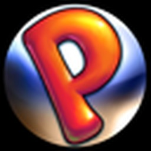

<div align=center>



</div>
<h1 align=center>Peggle — Nintendo Switch port</h1>

A native Nintendo Switch port of the Xbox 360 (Xbox Live Arcade) version of **Peggle** (2009), with **Title Update
#3** and, if you have it, the **Peggle Nights** add-on.

It's not an emulator. The PowerPC code of the game's `default.xex` is statically recompiled to C++ with
[ReXGlue](https://github.com/rexglue/rexglue-sdk) and compiled for the Switch, and the game is drawn by Renut's
Direct3D-level renderer ([reNut](https://github.com/masterspike52/reNut) by masterspike52, as banjo-nx carries it)
directly on the Switch's own graphics API, deko3d. It is made from the [Peggle 2 port](https://github.com/ChanseyIsTheBest/peggle2-nx)'s
code.

> [!NOTE]
> You need your own copy of the game, from your own Xbox 360:
> - the **Xbox Live Arcade** game, its content package
>   (`Content/0000000000000000/58410889/000D0000/87D0A5D366F24C8FF8BEE120E5F72D78F100E189`);
> - its **Title Update #3** (needed: the port's code is the updated program);
> - **Peggle Nights** (optional), its content package (`…/58410889/00000002/6AE5772224F8D86683B03E3A1B7509A48D1D4AAE58`).

## How to install

1. Open the installer page: **https://chanseyisthebest.github.io/peggle1-nx-installer/**
2. Choose your files (the packages, or a folder that holds them all) and press **Create peggle1-nx.zip**. Everything
   runs in your browser and the game files never leave your computer: the page checks your copies, downloads the
   build, and makes the shaders and the game pack from your files.
3. Extract the downloaded `peggle1-nx.zip` into `sdmc:/switch/`.

Your `peggle1-nx` folder should look like this:

```text
/switch/peggle1-nx/
  peggle1.nro
  LICENSES.txt
  peggle1.toml              (your settings; written at the first start when it is missing)
  deko3d_glsl.bin           (the game's shaders for the renderer, made from your copy)
  game_root.nxpack          (the game with its title update, in one file)
  game_root.nxidx
  dlc/                      (Peggle Nights, installed into the save folder at the first start)
```

Launch it with a game override (hold **R** while starting an installed title) or a forwarder. Album applet mode does
not give the game enough memory. If you use a forwarder, set it to a **39-bit address space**.

To build everything yourself instead, see [docs/building.md](docs/building.md).

> [!CAUTION]
> **The first time you play**, the game compiles the shader variants it has not seen yet, so **it can stutter for a
> moment** in new places. They are saved in `deko3d_shaders.bin` next to the NRO and later sessions start smoothly.

## Controls

By default the face buttons work **by position, as on the Xbox 360 pad** the game was made for: the bottom button
shoots (the Xbox's A), the right one is the Xbox's B, and so on.

<div align="center">

| Switch | Xbox 360 |
| --- | --- |
| B (bottom) | A |
| A (right) | B |
| Y (left) | X |
| X (top) | Y |
| ZR / ZL | RT / LT |
| R / L | RB / LB |
| + | Start |
| − | Back |
| Sticks / D-pad | Sticks / D-pad |

</div>

To use the buttons by letter instead (the Switch's A acts as A), set `input_xbox_layout = false` in `peggle1.toml`.

**Multiplayer:** Same Console Duel works: the second controller joins on the character screen. Every controller is
its own player, in the order they connect (the console in handheld mode counts as one). Single Joy-Cons are held
sideways, one per player. The Xbox Live modes are not available.

## Settings

`peggle1.toml`, next to the NRO, holds only your options. Everything else is built into the NRO.

<div align="center">

| Setting | What it does |
| --- | --- |
| `peggle1_language` | Empty (default): the console's system language (English when the game does not have it). Or `en`, `ja`, `de`, `fr`, `es`, `it`, `ko`, `zh` (traditional Chinese) or `pt` |
| `input_xbox_layout` | Face buttons by position (`true`, default) or by letter (`false`) |
| `input_joycon_sideways` | Single Joy-Cons held sideways, one per player (`true`, default) |

</div>

If you delete `peggle1.toml`, the game writes the default one again at the next start.

## Resolution and performance

The game draws **1280x720**, the resolution its menus and title art were made for, in handheld and docked mode. It
runs at **60 FPS**, as on the Xbox 360. The release keeps no log files; only a crash writes `logs/rex/rex_crash.log`.

Peggle is light work for the Switch, so the NRO is built without LTO or PGO.

## How it works

- **The game's code is translated, not emulated.** [ReXGlue](https://github.com/rexglue/rexglue-sdk) translates every
  function of the game's program to C++, which is then compiled for the Switch. ReXGlue also gives the game what it
  expects from an Xbox 360: its system, files, saves, audio and controllers. The port adds the Switch part: memory,
  threads, crash handling, clocks, audio output and showing the frames on screen.
- **Renut's renderer on deko3d.** The game's Direct3D calls are drawn directly by Renut's Direct3D-level renderer
  ([reNut](https://github.com/masterspike52/reNut) by masterspike52, in banjo-nx's Switch port of it) through
  [plume](https://github.com/renderbag/plume)'s deko3d back end.
- **Shaders translated beforehand.** The game stores its 82 GPU programs in its executable; the installer applies the
  title update, then translates them with [XenosRecomp](https://github.com/hedge-dev/XenosRecomp), DXC and
  SPIRV-Cross into deko3d's GLSL in your browser (`deko3d_glsl.bin`). The console compiles each shader variant once
  with [uam](https://github.com/devkitPro/uam) and keeps it in `deko3d_shaders.bin`.
- **Optimization.** The 30 busiest game functions run as translated native code (checked call by call against the
  original in the test builds), and the code generator keeps registers in C++ locals and makes calls direct. The
  game's five job threads, which spun on their job event whenever the queue was empty, sleep instead.

## Documentation

<div align="center">

| Document | What it explains |
| --- | --- |
| [docs/building.md](docs/building.md) | How to build the PC test build, the NRO and the game data |
| [docs/peggle1-notes.md](docs/peggle1-notes.md) | Notes on the game's code and every change of the port, each with its evidence |
| [docs/peggle2-notes.md](docs/peggle2-notes.md) | The Peggle 2 port's notes: the code this port is made from |

</div>

## Build

Windows, LLVM clang 20 and the VS 2022 Build Tools for the PC build; devkitA64, libnx and deko3d from
[devkitPro](https://devkitpro.org) for the Switch, with uam and SPIRV-Cross built for the PC
(`tools/deko3d_build_tools.sh`); Python; and your own copy of the game. The whole process is in
[docs/building.md](docs/building.md).

<div align="center">

| Folder | Contents |
| --- | --- |
| `app/` | The game: hooks, Renut's renderer (`app/src/renut_engine`), native functions, settings, CMake project; `app/thirdparty`: plume, uam, Dear ImGui and Renut's XenosRecomp |
| `sdk/` | ReXGlue SDK with the Horizon layer and the code generator changes |
| `shaders/` | XenosRecomp with the ports' changes, and the shader package tools |
| `tools/` | Code generation steps, build and test scripts |
| `docs/` | Documentation |

</div>

## Credits

- **PopCap Games** — creators of Peggle. This is an unofficial, fan-made port with no affiliation.
- **ChanseyIsTheBest** — this port and the Peggle 2 port it is made from.
- **[Tom Clay](https://github.com/rexglue/rexglue-sdk)** — the ReXGlue SDK, built on the work of the
  **[Xenia](https://xenia.jp)** team.
- **[StevensND](https://github.com/StevensND/nfsmw-nx)** — nfsmw-nx: the Switch layer of the SDK and much of the
  method; and [nfsmw-nx-installer](https://github.com/StevensND/nfsmw-nx-installer), the installer page this port's
  is built on.
- **[masterspike52](https://github.com/masterspike52/reNut)** — reNut: the Direct3D-level renderer the port draws
  with (its reuse in this port permitted by its author).
- **banjo-nx** (Banjo-Kazooie: Nuts & Bolts Switch port) — Renut's Switch port: the deko3d back end of plume, the
  shader generator and its optimisations, the render-thread and input-latency work.
- **[renderbag](https://github.com/renderbag/plume)** — plume, the rendering layer Renut draws through;
  **[fincs](https://github.com/devkitPro/uam)** and devkitPro — deko3d and uam.
- **[nebadasSwifty](https://github.com/nebadasSwifty/masseffect-nx)** — masseffect-nx, where much of the ports'
  renderer and CPU work began.
- **[hedge-dev](https://github.com/hedge-dev/XenosRecomp)** — XenosRecomp, the Xenos shader translator.
- **[devkitPro](https://devkitpro.org) and [switchbrew](https://github.com/switchbrew/libnx)** — devkitA64 and libnx.
- The sibling ports (Sonic Adventure 2, Banjo-Kazooie: Nuts & Bolts, Sonic & All-Stars Racing Transformed,
  Mushihimesama Futari), which share their fixes with this one.
- The other libraries listed in [THIRD_PARTY_NOTICES.md](THIRD_PARTY_NOTICES.md).

## Legal

No affiliation with PopCap Games, Electronic Arts, Microsoft or Nintendo. "Peggle" is a trademark of PopCap Games /
Electronic Arts; the icon (`app/icon.jpg`, the game's own icon) is © PopCap Games. Apart from that icon, this
repository contains no assets or program code from the original game. Users must provide their own legally obtained
copy, and everything made from it (`assets/`, `app/generated/`, the shader package, the game pack) is made on their
own computer. Running homebrew requires custom firmware, which violates Nintendo's ToS and can get a console banned —
your call.

Source code is provided under the GPL-3.0 License (see [LICENSE](LICENSE)), like the ports it builds on. The SDK keeps
its BSD-3-Clause license (see [THIRD_PARTY_NOTICES.md](THIRD_PARTY_NOTICES.md)).
