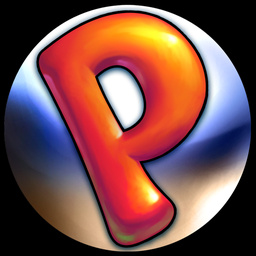

<h1 align=center>Peggle: Nintendo Switch port</h1>

<b>peggle1-nx 1.0.3</b> · <a href="https://chanseyisthebest.github.io/peggle1-nx-installer/">web installer</a> · <a href="https://github.com/ChanseyIsTheBest/peggle1-nx/releases/tag/v1.0.3">release</a>

An unofficial native port of the Xbox 360 (Xbox Live Arcade) version of **Peggle**, with Title Update #3 and, if you
have it, the **Peggle Nights** add-on. Made by static recompilation with [ReXGlue](https://github.com/rexglue/rexglue-sdk), from the
[Peggle 2 port](https://github.com/ChanseyIsTheBest/peggle2-nx)'s code. No emulator.

This repository contains no game files. You need your own copy of the game from your Xbox 360: the Xbox Live Arcade
content package (`58410889`), its **Title Update #3** (required), and Peggle Nights if you want it (optional).

## Playing it on the Switch

1. Open the web installer: **https://chanseyisthebest.github.io/peggle1-nx-installer/**
2. Give it your packages (or a folder that holds them all) and press **Create peggle1-nx.zip**. Your files never leave
   your computer.
3. Extract `peggle1-nx.zip` into `sdmc:/switch/`.
4. Start it with a title override (hold **R** while starting an installed game) or a forwarder.

- Album applet mode does not give the game enough memory.
- A forwarder must be set to a **39-bit address space**.
- The first time you play, the game can stutter for a moment in new places while it compiles shaders. Later sessions
  start smoothly.

Features:

- Peggle with Title Update #3, and Peggle Nights if you have it.
- Native deko3d renderer (Renut); 1280x720 in handheld and docked, 60 fps as on the Xbox 360.
- Same Console Duel: the second controller joins on the character screen; every controller is its own player.
- The console's system language by default, or `peggle1_language`: `en`, `ja`, `de`, `fr`, `es`, `it`, `ko`, `zh`
  (traditional Chinese) or `pt`.
- Face buttons work by position as on the Xbox 360 pad (`input_xbox_layout = false` for by letter); single Joy-Cons
  held sideways, one per player.
- Settings are in `peggle1.toml` next to the NRO; delete it to get the defaults back.
- A game menu: hold **A + B + X + Y + L + R** together (**+** closes it) for the settings (language, rumble, button
  layout, Joy-Con, and the menu's own buttons, colour, font and background), the achievements and each player's
  controls. It saves your choices in `peggle1.toml`.
- Rumble: the game's own vibration, on by default (off in the menu, or `input_rumble = false`).
- A smaller install: the installer stores the game files compressed, with the sounds as Opus and the PopCap logo movie
  as H.265 (played by the Switch's video decoder).
- Peggle Nights is read straight from its package; nothing is unpacked.
- No log files, except `logs/rex/rex_crash.log` after a crash.

Known issue:

- The Xbox Live modes are not available.

## Building

Needs Windows with LLVM clang 20 and the VS 2022 Build Tools (PC build); devkitA64, libnx and deko3d from
[devkitPro](https://devkitpro.org) (Switch build), with uam and SPIRV-Cross built for the PC
(`tools/deko3d_build_tools.sh`); Python; and your own copy of the game.

The steps (PC test build, NRO, game data) are in [docs/building.md](docs/building.md). More in
[docs/peggle1-notes.md](docs/peggle1-notes.md) and the Peggle 2 port's [docs/peggle2-notes.md](docs/peggle2-notes.md).

## Credits and license

- **PopCap Games**: creators of Peggle. This is an unofficial, fan-made port.
- **ChanseyIsTheBest**: this port and the Peggle 2 port it is made from.
- **[Tom Clay](https://github.com/rexglue/rexglue-sdk)**: the ReXGlue SDK, built on the work of the
  **[Xenia](https://xenia.jp)** team.
- **[StevensND](https://github.com/StevensND/nfsmw-nx)**: nfsmw-nx (the SDK's Switch layer and much of the method) and
  [nfsmw-nx-installer](https://github.com/StevensND/nfsmw-nx-installer), which the installer page is built on.
- **[masterspike52](https://github.com/masterspike52/reNut)**: reNut, the renderer (reused with its author's permission).
- **banjo-nx** (Banjo-Kazooie: Nuts & Bolts port): Renut's Switch port (plume's deko3d back end, the shader generator,
  render-thread and input-latency work).
- **[renderbag](https://github.com/renderbag/plume)**: plume. **[fincs](https://github.com/devkitPro/uam)** and
  devkitPro: deko3d and uam.
- **[nebadasSwifty](https://github.com/nebadasSwifty/masseffect-nx)**: masseffect-nx, where much of the ports'
  renderer and CPU work began.
- **[hedge-dev](https://github.com/hedge-dev/XenosRecomp)**: XenosRecomp.
- **[devkitPro](https://devkitpro.org)** and **[switchbrew](https://github.com/switchbrew/libnx)**: devkitA64 and libnx.
- The sibling ports (Sonic Adventure 2, Banjo-Kazooie: Nuts & Bolts, Sonic & All-Stars Racing Transformed,
  Mushihimesama Futari), which share their fixes.
- The other libraries in [THIRD_PARTY_NOTICES.md](THIRD_PARTY_NOTICES.md).

GPL-3.0 (see [LICENSE](LICENSE)); the SDK keeps its BSD-3-Clause license (see
[THIRD_PARTY_NOTICES.md](THIRD_PARTY_NOTICES.md)).

No affiliation with PopCap Games, Electronic Arts, Microsoft or Nintendo. "Peggle" is a trademark of PopCap Games /
Electronic Arts; the icon (`app/icon.jpg`, the game's own icon) is © PopCap Games. Apart from that icon, this
repository contains no assets or program code from the original game: you provide your own legally obtained copy, and
everything made from it is made on your own computer. Running homebrew requires custom firmware, which violates
Nintendo's ToS and can get a console banned.
